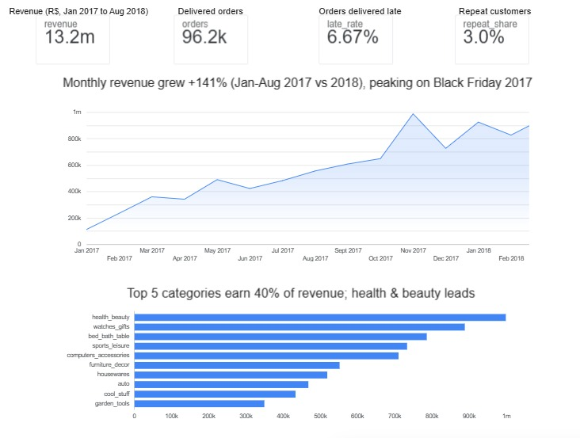
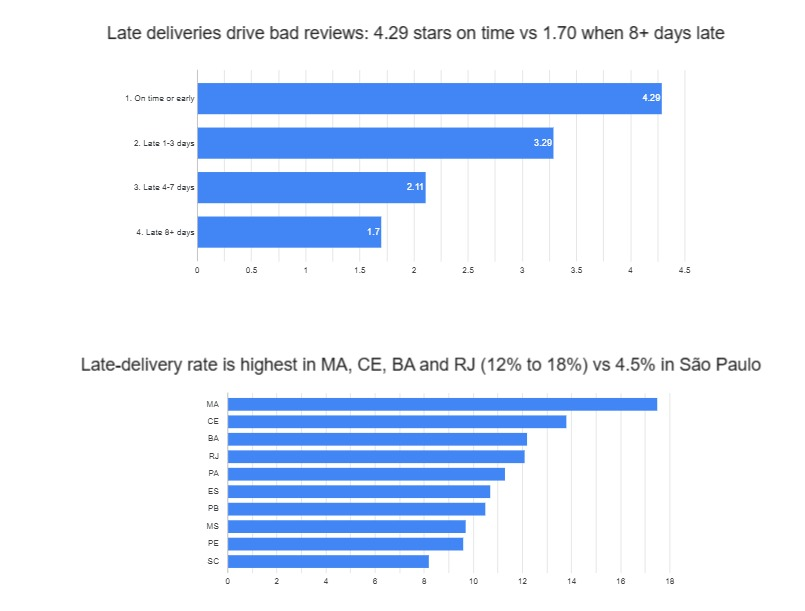

# Olist E-Commerce Analytics (SQL + Looker Studio)

**Live dashboard:** https://datastudio.google.com/reporting/a4159253-6994-4b7f-bfde-19e318e1fa39

Analysis of Olist's Brazilian e-commerce marketplace data (Kaggle) using SQL (DuckDB), Python and Looker Studio. Period analysed: Jan 2017 to Aug 2018.

## Business questions
1. How is revenue trending?
2. Which categories drive growth?
3. Do customers come back?
4. Does late delivery hurt customer satisfaction, and where is it happening?

## Key findings
- **Revenue:** Delivered-order revenue grew from R$2.99M (Jan-Aug 2017) to R$7.22M (Jan-Aug 2018), +141%, driven by order volume (+140%); AOV stayed flat (~R$136). Revenue peaked in Nov 2017 (R$988K), when 24 Nov (Black Friday) had 1,147 orders, about 6x the daily average of the days before, and plateaued in 2018.
- **Categories:** The top 5 categories earn 40% of revenue. Health & beauty (+210% YoY) and watches & gifts (+242%) grew faster than the marketplace (+141%); cool stuff grew only 10%.
- **Retention:** 97% of customers (90,315 of 93,104) bought only once; repeat customers were 3% of customers and 5.5% of revenue.
- **Delivery vs reviews:** On-time orders averaged 4.29 stars; the 6.7% of orders delivered late averaged about 2.3, and 79% of orders 8+ days late got 1-2 star reviews (vs 9% for on-time).
- **Where delays happen:** Late-delivery rates are highest in MA (17.5%), CE (13.8%), BA (12.2%) and RJ (12.1%) vs 4.5% in SP. RJ accounts for 24% of late orders (1,495) from 13% of orders.

## Recommendations
- Prioritise inventory and promotions in fast-growing categories; investigate why cool stuff stalled.
- Test a post-purchase follow-up to lift the 3% repeat rate and track repeat rate as a KPI.
- Monitor the share of orders arriving 4+ days late; focus carrier and estimate improvements on RJ and the North-East first.

## Definitions
- Revenue = sum of item prices (freight excluded), delivered orders only, in R$.
- AOV = revenue / delivered orders.
- Customers identified by `customer_unique_id`.
- Late = delivered after the estimated delivery date.
- Months with almost no orders (Sep 2016 to Dec 2016, Sep to Oct 2018) were excluded.

## Limitations
- Public marketplace sample, not Olist's complete business; findings describe this dataset.
- Late delivery and reviews are associated; other factors also affect reviews.
- Repeat rate may be understated for customers acquired late in the window.

## Tools
SQL (DuckDB), Python (pandas, matplotlib), Looker Studio

## Data
Brazilian E-Commerce Public Dataset by Olist (Kaggle: https://www.kaggle.com/datasets/olistbr/brazilian-ecommerce). Not included in this repo; download and place the CSVs in `data/`.
